# Timonier

**English** · [Français](README.fr.md)

Timonier is a VSCode extension and a local daemon that let you steer AI coding agents without
reading every line they write. It keeps a live map of your code's architecture, compares it
with the architecture you drew, shows what changed since your last review, and gives the agents
the same plan, todo and constraints you see.

**Languages:** Rust, TypeScript, JavaScript, Python, Go, Java, Kotlin, Scala, C, C++, C#, Swift and PHP.

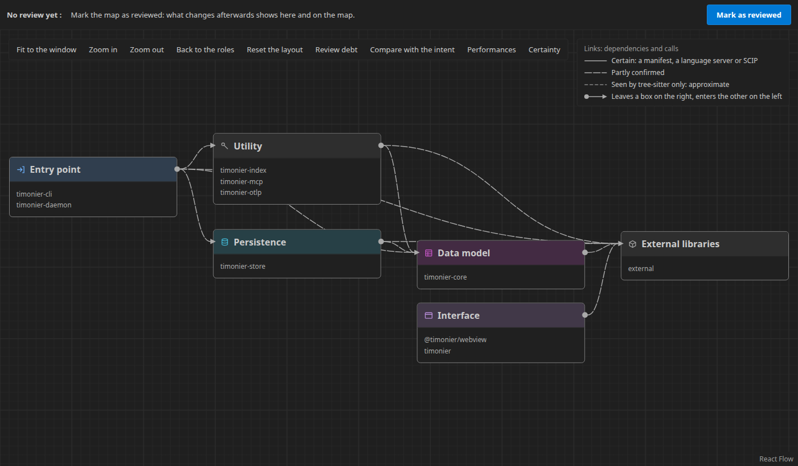

## The problem

When an agent writes the code, writing is no longer the bottleneck; understanding is. The code
changes faster than your mental model of it, and reading every diff does not scale. Timonier
keeps that model for you and answers four questions at any time:

- **What I want**: the intended architecture, drawn on a whiteboard.
- **What exists**: the real architecture, extracted from the code and kept up to date.
- **How it behaves**: time and resources, measured while the tests run.
- **What is happening**: the plan, the live todo, what the agent did and where to look.

The name: the *timonier* is the helmsman, who holds the wheel while the crew, here the agents,
moves the ship.

## A tour

The screenshots below come from the extension's development page, with sample data, in
VSCode's Dark Modern theme. The extension follows your theme: light, dark or high contrast.

### The architecture map

The map opens on a few boxes named by role: entry point, data model, persistence, interface,
utility, external libraries. Timonier itself fits in six. A click opens a box on its packages,
then on its components, files and symbols. Dashed links are known only from syntax
(tree-sitter); solid links are declared in a manifest or confirmed by the IDE's language
servers. The layout stays stable as the code changes, and Shift+Enter opens the code of a box.

### What changed since your review

« Mark as reviewed » freezes the map as you saw it. From then on, a banner says what changed:
new, modified and removed boxes, dependencies added and removed, cycles added. The map marks
each change with a shape and a word, so you know where to look before you open a file.

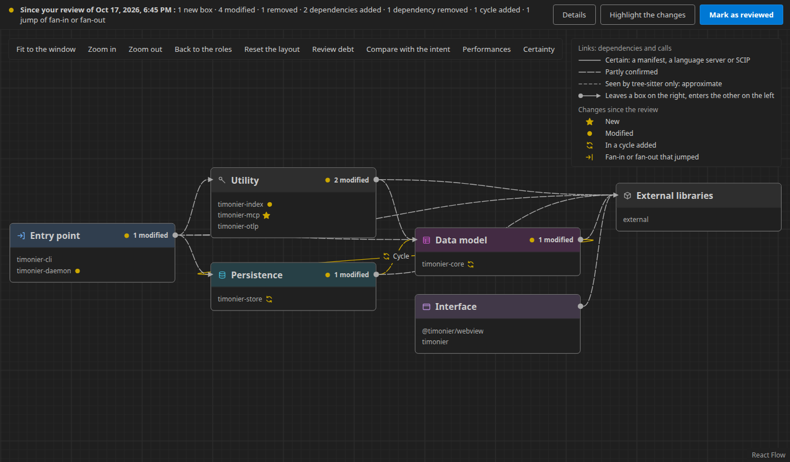

The review debt layer counts, on each box, the files changed since your review that you have
not read again. Files changed while no agent session was open are hatched and marked
« untracked ».

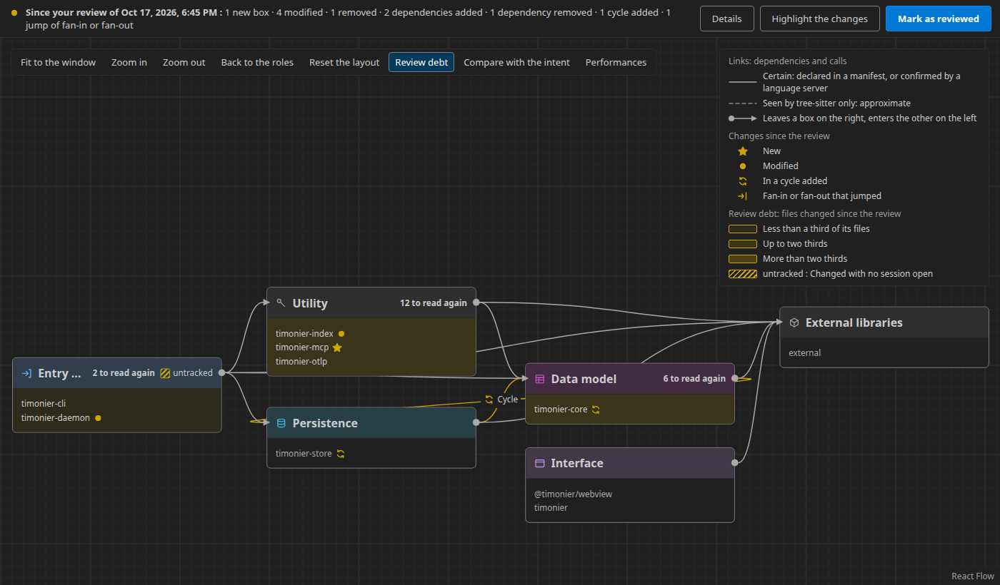

### The whiteboard

You draw the architecture you want, freehand or with typed shapes: a box is a component, a zone
a layer, an arrow a dependency that is allowed, forbidden or required, a note a constraint, a
budget note a performance limit. Every gesture is saved to `.timonier/intent.json`, which the
agents read and never write.

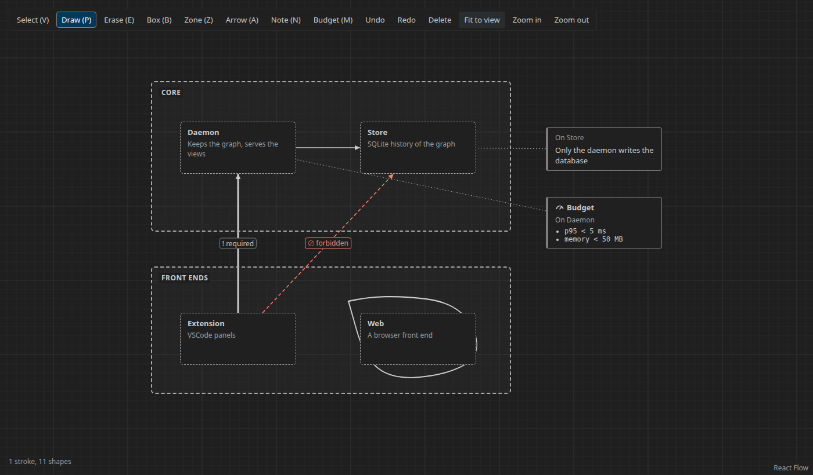

« Compare with the intent » puts the two side by side on the map: the drawn components the code
lacks, the forbidden edges it crosses (and which dependencies cross them), the required edges
missing.

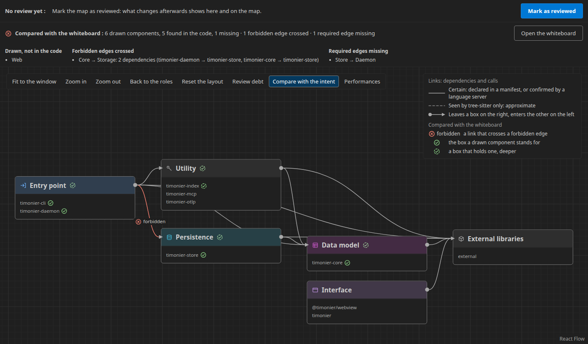

### Plan, todo and sessions

Agents work through Timonier's tools: they open a session for each task, split it into a todo,
and update the plan as they go. A side panel shows it live, with each session's journal: its
objective, the components it touched, its summary, and its AI cost: the tokens Claude Code
reports in its own telemetry while the session was open, the dollars as its estimate.
`timonier init` turns that telemetry on in `~/.claude/settings.json` when you agree; without it,
the session says « not measured ».

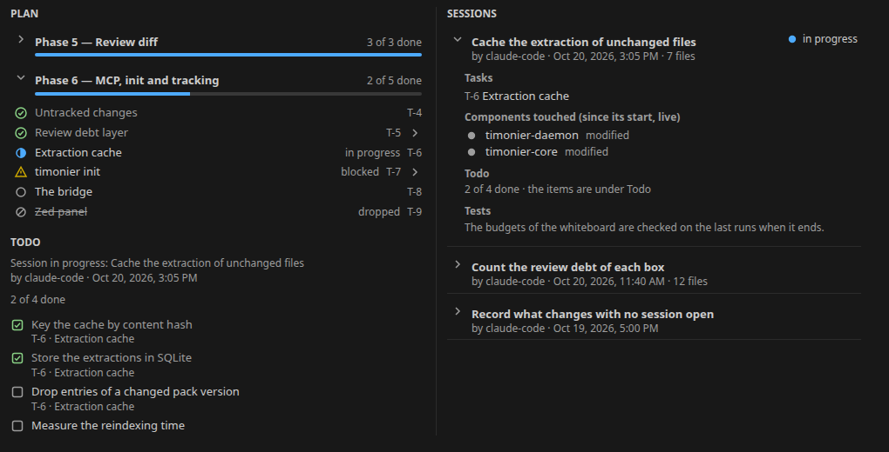

The bridge, Timonier's home view, answers three questions at a glance: where the plan stands,
what happened since your last review, and where to look first.

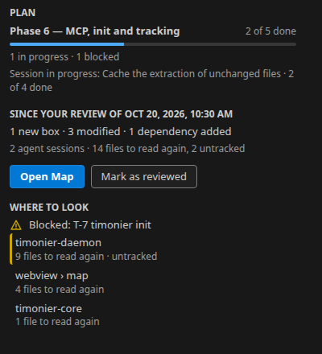

### Agents, through MCP

`timonier mcp` is an MCP server for coding agents (Claude Code, GitHub Copilot, Cursor, Codex).
Besides the tracking tools, it gives the agent the whiteboard (with an image of the sketch),
the drift of the code from it, the performance budgets and their violations, the
instrumentation conventions, the technology inventory (licences, duplicates by function, known
vulnerabilities from OSV.dev) and the project's development process: Solo fast, Solo
disciplined (an issue, a branch and a pull request per task, through `gh`) or Team. The
bridge's **Set up** configures the agents you tick; `timonier init` does the same from a
terminal, `timonier doctor` checks and repairs that setup, and `timonier uninit` takes it back.

### Performances

`timonier test` runs your tests and measures them: time, CPU, peak memory (of the whole process
tree on Linux, in a systemd scope; of the largest process on macOS; the wall time only on
Windows), the duration of each test,
and the OpenTelemetry traces of the code under test, attached to the boxes of the map. The
map's Performances layer shows the time spent in each box and in what it called, and draws
links thicker as more calls go through them.

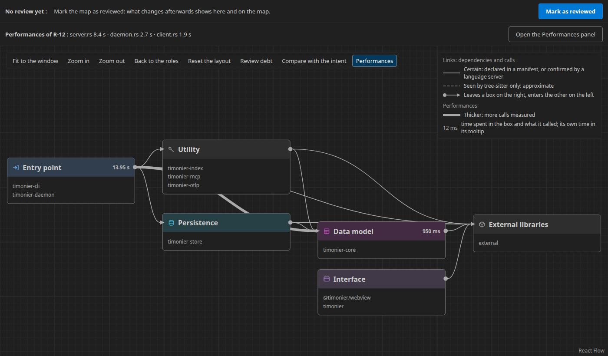

A budget from the whiteboard that the last runs exceed marks its box in red, whether the layer
is on or not.

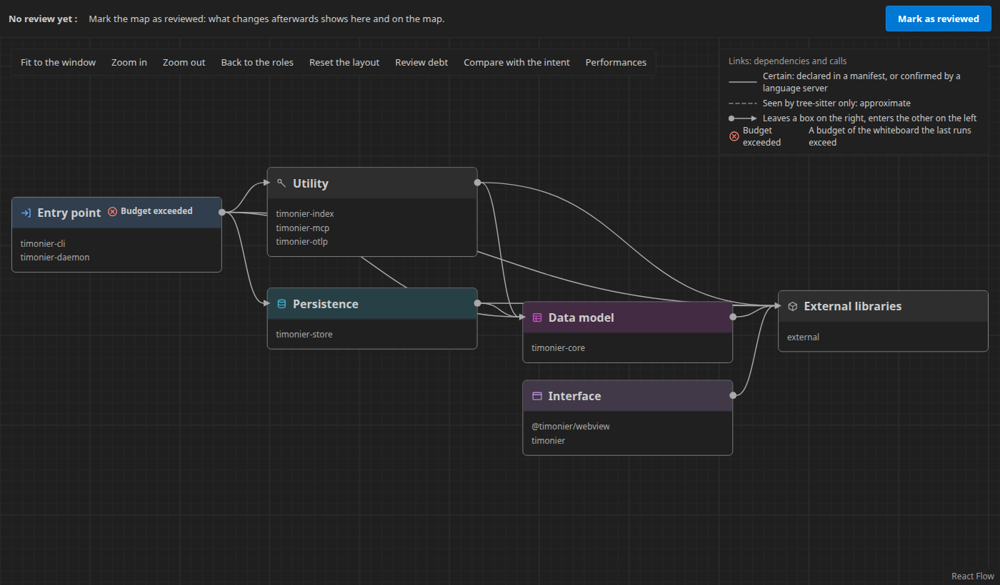

The Performances panel shows a run: the timeline of each test with its spans and the process's
memory and CPU, the call tree with total and own time, and the evolution of the runs by commit.
With `timonier test --runs auto`, it compares a batch of runs with the main branch and flags a
measure that is slower beyond doubt (Mann-Whitney, p < 0.01, and at least max(5 %, 3 MAD)).

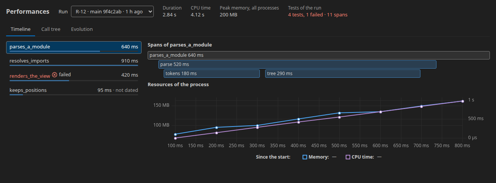

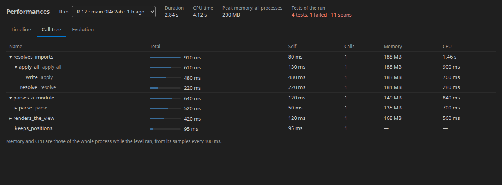

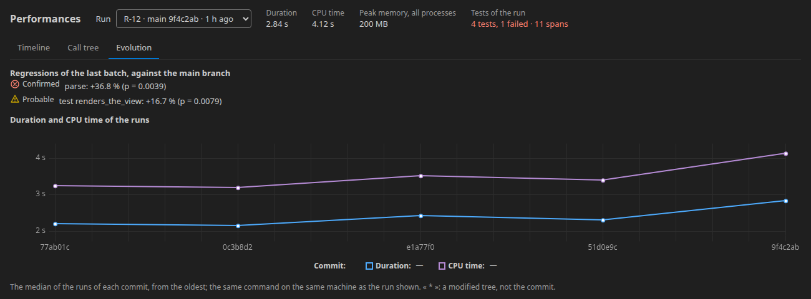

The full list of what works, with the figures measured on Timonier itself, is in
[docs/features.md](docs/features.md).

## How it works

- A **daemon** in Rust, one per project, indexes Rust, TypeScript, JavaScript, Python, Go, Java, Kotlin, Scala, C, C++, C#, Swift and PHP with tree-sitter, refines
  calls with the IDE's language servers, and keeps the graph and its history in SQLite.
- The **VSCode extension** subscribes to views of that graph over JSON-RPC and draws them with
  React Flow.
- **Agents** reach the same daemon through MCP; the plan, todo and journal are versioned JSON
  files in `.timonier/`.
- **Tests** send their OpenTelemetry traces to a receiver in the daemon, which attaches each
  span to its node of the graph.

The specification is [docs/spec.md](docs/spec.md); the plan ([PLAN.md](PLAN.md)) and the
decision records ([docs/adr/](docs/adr/README.md)) are in French.

## Status

Early development, not released yet (22 October 2026). The MVP is planned in phases 0 to 9
([PLAN.md](PLAN.md)): phases 0 to 8 are done. Phase 9, under way, has added the technology
inventory, the development process and the AI cost, and ported Timonier to Windows; it
publishes a pre-release on the VSCode Marketplace, then ends by steering a new project end to
end. Timonier steers its own development.

Phase 10, done before the pre-release, took Timonier from two languages to thirteen: each one
was checked on a real project, from the map to the first trace of its tests. Timonier runs on
Linux, macOS and Windows; its tests pass there in CI, and a first try on a real Windows machine
is under way. Nothing is published on crates.io, npm or the Marketplace yet. Later versions
add a skills manager, SCIP indexing, several agents working together, and team use: see the
[roadmap](ROADMAP.md).

## Try it

Requirements: Rust stable (`rustup`), Node.js 24 or later, VSCode 1.140 or later.

```sh
npm ci
npm run build                              # the webview, then the extension
cargo install --path crates/timonier-cli   # puts timonier and tim on the PATH
```

Open this repository in VSCode and press F5 (« Run Extension »). In the window that opens, open
a project in one of these languages, click the Timonier icon (a ship's wheel) in the activity bar, then
**Open Map**.

To set a project up for your agents, in the project:

```sh
tim init --dry-run   # shows what it would change
tim init             # --yes to ask nothing
tim doctor           # checks the setup and repairs it
tim test             # runs the tests init recorded, and measures them
tim inventory        # dependencies, licences, duplicates, known vulnerabilities
```

## Develop

```sh
cargo test --workspace
cargo clippy --workspace --all-targets -- -D warnings
npm test                          # webview, extension and hook unit tests
npm run test:integration          # the extension in a real VSCode, against a real daemon
npm run test:a11y                 # WCAG AA in every captured VSCode theme
npm run screenshots -w webview    # the images of this README
```

[CLAUDE.md](CLAUDE.md) lists every command, and how the project is steered.

## Acknowledgements

Thanks to Iban Guinebert and Michaël Roynard for the idea behind Timonier.

## License

[MIT](LICENSE) © 2026 Nicolas Michel. Third-party notices ship with the extension.
